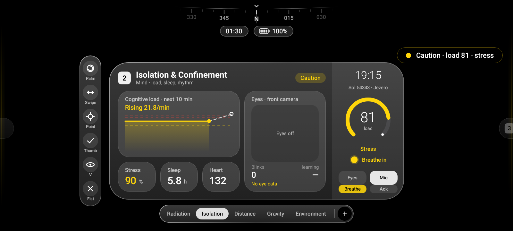
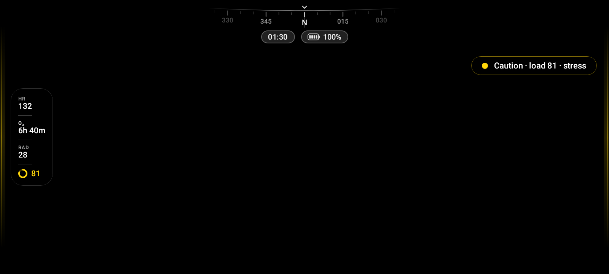
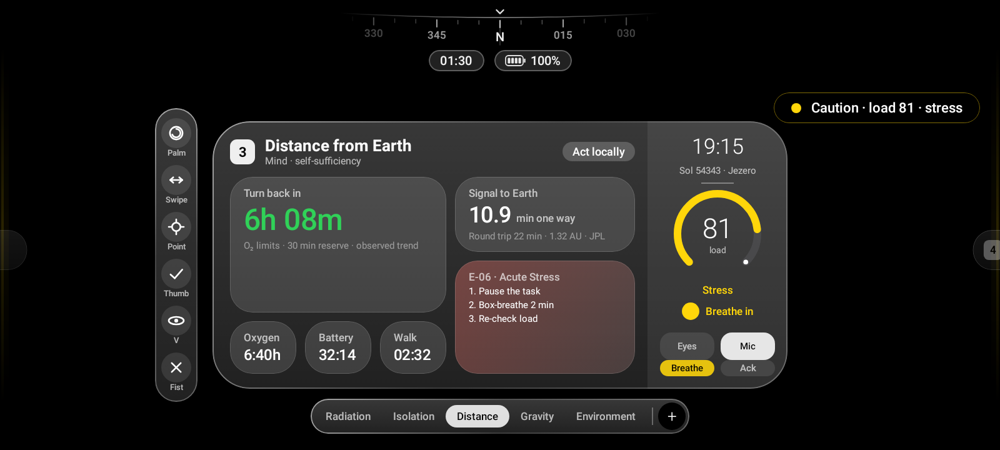
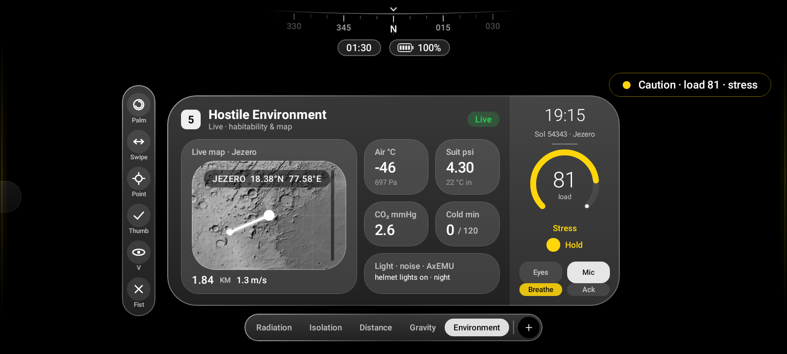

# NASA-STIBOTS · Mars Spatial HUD

**A hands-free AR heads-up display for astronauts on Mars that puts the mind first.**
It watches the five hazards NASA lists for human spaceflight, estimates the wearer's cognitive load from their eyes and body, forecasts the next ten minutes, and speaks up before things go wrong.

> Built in two days for a NASA Space Apps challenge. Our target is a helmet visor HUD; for this prototype an Android phone stands in for the display.

| Android app (v6) | Web demo (minimal, runs in a browser) | Source |
|---|---|---|
| [Download APK (Google Drive)](https://drive.google.com/file/d/1iGB3T-dR8KvnQVzS9Q34yFqft292CTmT/view?usp=sharing) | [Open web demo](https://3e8e8ec48fc0faf5f57dcd00f78a2827cfa.vercel.app/) | You're here |

*Install the APK on Android 7.0 or newer (allow "install unknown apps"), then grant camera and microphone access.*



---

## Why

Monitoring an astronaut's mental state in real time is still an **open problem**. NASA notes there is not yet enough data to characterise cognitive performance during spacewalks, and researchers point out that existing tools are not suited to real-time use during EVA. On Mars the problem is sharper: a message to Earth takes 3 to 22 minutes, so the crew has to notice trouble in themselves.

Our approach: a **calm-by-design HUD** that estimates mental load live, stays out of the way until it matters, and needs no hands.

## What it does

The dashboard is organised around **NASA's 5 Hazards of Human Spaceflight**. Hazards 1 to 3 focus on the mind, 4 on the body, and 5 on live visualisation. Each hazard is a window floating in space; turn your head to move between them.

| # | Hazard | What you see |
|---|---|---|
| 1 | **Space radiation** | Dose rate modelled on Curiosity rover data, live solar-flare risk from NASA DONKI (when online), hand steadiness (a motor-control check), route and ETA back to base |
| 2 | **Isolation & confinement** | **Cognitive load 0–100** from eyes, heart rate, stress, CO₂ and sleep, with a 10-minute forecast, a blink counter and Mars time |
| 3 | **Distance from Earth** | Signal delay to Earth from JPL orbit data; a turn-back countdown (oxygen, battery or the suit's 8 h rating, minus the walk back and a 30 min reserve) |
| 4 | **Gravity** | Mars-gravity (0.38 g) loading, exercise minutes against ISS references, step count |
| 5 | **Hostile environment** | Live Jezero crater map, Mars weather modelled on Perseverance data, suit pressure, CO₂, light, noise and cold exposure |

**Quiet view.** When the dashboard is closed, only the compass sits in the centre. Vitals sit on a thin left rail, alerts appear top-right, and a soft glow on the side edges grows with your mental load. Colour is strictly status: green = nominal, yellow = caution, red = warning.

**Alerts.** Cognitive load at 70 shows a breathing pacer. At 90 the HUD speaks once. At 95 it speaks your load and pulse every 20 seconds until you acknowledge.

| Quiet view | Distance | Environment |
|---|---|---|
|  |  |  |

## How it estimates cognitive load

1. **Learns your normal.** It counts your blinks over the first 2 minutes to set your personal baseline.
2. **Eyes.** Blinking below your baseline suggests heavy focus. More blinks, longer blinks or longer eye closure (PERCLOS) suggest fatigue.
3. **Body and environment.** Heart rate above what your activity explains, stress, helmet CO₂ (NASA-STD-3001 limit of 3 mmHg), core temperature and sleep.
4. **Fuses** these into one score (eyes 35%, body 40%, environment 15%, sleep 10%), pulled toward the worst signal so one critical factor is never averaged away.
5. **Forecasts** ten minutes ahead from the five-minute trend.

Eyes alone can never trigger a warning; another signal has to agree. The score is research-informed but **not clinically validated**. It is a warning aid, not a diagnosis.

## Controls (v6 presenter tuning)

| Action | Voice | Gesture |
|---|---|---|
| Open dashboard | "open dashboard" | Hold an open palm for 0.7 s |
| Close dashboard | "close dashboard" | Hold a fist for 1.2 s |
| Go to a hazard | "radiation", "isolation", "distance", "gravity", "environment" | Turn your head or swipe an open hand |
| Drills | "drills" | Look down |
| Run a drill | "emergency one" … "emergency ten" | |
| Clear everything | "end all emergencies" / "all clear" | |
| Silence an alert | "acknowledge" / "silence" | Thumbs-up |
| Keep the window in front of you | "center lock" | Point and hold |
| Microphone | "calibrate", "sensitivity up", "sensitivity down" | |
| Exit | | Tap the top-right corner 5 times |

Voice runs **offline**. Pause briefly after each command.

## Honest scope

| Works today | Built, still being proven | Next |
|---|---|---|
| HUD software running live; gestures and offline voice; eye-based load indicator fused with vitals; Mars context from NASA data; escalating spoken alerts | Phone-to-phone crew alerts over Wi-Fi; live NASA space weather; eye tracking across phone models | Real wearables (heart rate, sleep); a real head-mounted display; testing with analog-mission crews |

**Simulated in this prototype:** heart rate (follows walking speed), blood pressure, SpO₂, core temperature, hydration, sleep and suit consumables. **Modelled from NASA data, not measured:** radiation dose and Mars weather. **Sensed live:** gestures, blinking, GPS, heading, steps, light and noise.

## NASA data and sources

* **Mars24** (NASA GISS): Mars local time at Jezero (reproduces the Perseverance landing time, 3:53 p.m. local)
* **JPL** *Approximate Positions of the Planets*: Earth–Mars distance and signal delay (matches the 2025 closest approach, 0.642 AU)
* **NASA DONKI**: live solar flares and particle events
* **Curiosity RAD**: 0.67 mSv/day surface radiation baseline
* **Perseverance MEDA**: Jezero weather
* **NASA SUITS telemetry server (TSS2026)**: suit telemetry fields and formulas
* **NASA-STD-3001**: CO₂ limit · **NASA Human Research Program**: the five hazards
* **Research:** Barger et al. 2014 (astronaut sleep); NASA Cognition test battery (2024); blink and fatigue studies (Nature Sci. Reports 2025, FAA AM-94/17, Maffei & Angrilli 2018); PERCLOS drowsiness research
* **Partner:** Axiom Space AxEMU suit profile (8 h EVA rating, 2 h cold rating, helmet lights)

## Build

Android (Kotlin, Jetpack Compose, CameraX, MediaPipe, Vosk). Min SDK 24.

```bash
./gradlew assembleDebug
./gradlew testDebugUnitTest   # 50 unit + UI tests
```

Optional: put a free NASA API key in `.env` as `NASA_API_KEY=...` (defaults to `DEMO_KEY`).

## Team

STIBOTS: *add names here*
